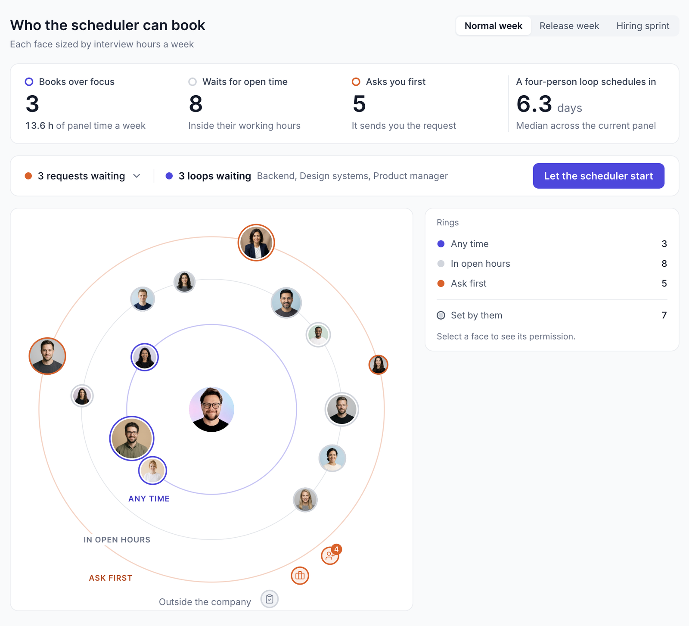

# Permission rings

**The question:** when a scheduling agent can take other people's time, how does a
person say *how far* it may go — without a settings page nobody reads, and without
turning every booking into a request?

[Live demo →](https://permission-rings.vercel.app)



*Rings — drag a face inward to let the scheduler book more freely, outward to make it ask. The numbers above move while you drag.*

## What it is

A hiring manager's view of an interview scheduler that books on their behalf. Every
interviewer on the panel sits on one of three rings around you:

- **Any time** — the scheduler may book over their focus time.
- **In open hours** — it waits for a free slot inside their working hours.
- **Ask first** — it sends you the request and does nothing until you answer.

Outside the company — candidates, an agency, a vendor — there is a fourth state,
**Not bookable**, which people inside never get. Faces are sized by how many hours a
week each person already spends interviewing, so the cost of pulling someone inward
is visible before you do it.

Three contexts — *Normal week*, *Release week*, *Hiring sprint* — hold three separate
sets of rings. Switching context moves the faces and says what changed: *"6 people
moved out, 6.3 h of panel time protected."*

A second screen, [`/loop`](https://permission-rings.vercel.app/loop), shows what the
scheduler does with those permissions: one candidate's four-interview loop, two slots
booked, one waiting on someone who is out of office, one declined. The scheduler lays
out its plan in time — *Thu 09:00 asks Jonas again · Thu 17:00 proposes someone else ·
Fri 09:00 stops asking and hands the loop back to you* — and every underlined word in
that plan is a choice you can change.

Both screens follow the system theme, with a System / Light / Dark switch in the header.

## The decision moment

Most agent permission models are a switch: the assistant can act, or it can't. The
switch is set once, in a settings page, by someone who has to imagine the
consequences. Then the agent either annoys everyone by asking, or surprises everyone
by not asking.

This prototype makes the permission a *distance*. Closer to you means more freedom
for the agent, and the screen keeps a running total of what that freedom costs: hours
of other people's focus time, how many days a four-person loop takes to schedule, how
many candidates are waiting on a slot that only you can unblock. Move Jonas from *Ask
first* to *Any time* and the loop estimate drops, a candidate flips from *Waiting 31 h*
to *Unblocked, booking now*, and a toast offers to undo it.

## Four decisions I'd defend

**1. Consequences, not descriptions.**
A ring is not labelled "high trust". It is labelled by what the scheduler will
actually do — *Books over focus*, *Waits for open time*, *Asks you first* — and the
scoreboard counts what that means this week. People set permissions well when they
can see who pays for them.

**2. Some faces are locked, and the lock has a name.**
Some people set their own ring. You can see where they put themselves and you can't
move them: *"Only Priya can change this."* A permission system that lets a manager
override everyone's boundaries isn't a permission system.

**3. Permissions can end.**
Any ring you set can carry an end date — until this Friday, or the one after.
Loosening something for a hiring sprint shouldn't need a reminder to tighten it back.
The expiry is set where the permission is set, not in a separate place.

**4. The agent shows its plan before it runs, as a timeline.**
On the loop screen the scheduler doesn't say "I'll handle it". It says what it will do
at 09:00 on Thursday, at 17:00 on Thursday, at 09:00 on Friday — and the parts you'd
want to change (how often to ask, who to propose instead, who gets the loop back) are
the editable words in those sentences. Plans you can read are plans you can correct.

## What I found by building it

The thing that only showed up in code was the drag. In a static comp, three rings
with faces on them look like a diagram. The moment a face can be grabbed, the empty
space between the rings becomes the question — the pull toward one ring or another
had to be removed entirely, because any easing read as the system having an opinion
about where the person belongs. Now a face follows the cursor exactly and snaps to
the nearest ring only when you let go.

The second thing was the hover. The first version zoomed a face on hover *after* it
had been placed, so the zoom also moved it sideways by a few pixels — and a face that
shifts when you reach for it reads as a face you can't trust to grab. The fix was to
separate placement from scale, so a face grows around its own centre and the point
you aimed at is the point you catch.

## Deliberately not built

Real calendars · real people · a settings page · teams or departments as groups ·
permission inheritance · an audit log · notifications to the people whose ring
changed · mobile. → changed · a phone-first layout.

Each of those is a real feature. None of them helps answer the question above, and
the list of things I chose not to build is part of the work.

## What I'd test next

Whether people read *Any time* as trust or as a cost. My prediction: managers put
their most senior people on the inner ring because that reads as respect, and the
panel-hours number has to be loud enough to argue back. The second thing is the
locked faces — how it feels to see where someone put themselves, and whether the
manager asks them to move or quietly routes around them.

## Running it

```bash
pnpm install
pnpm dev
# → http://localhost:3000      the rings
# → http://localhost:3000/loop one candidate's loop
```

Next.js 16 · React 19 · Tailwind 4 · Base UI. No backend, no model calls; the
scheduler's behaviour is scripted and the people are invented.

Built in my own time. Fake data throughout, no production code and nothing
proprietary — just enough to feel the interaction.
